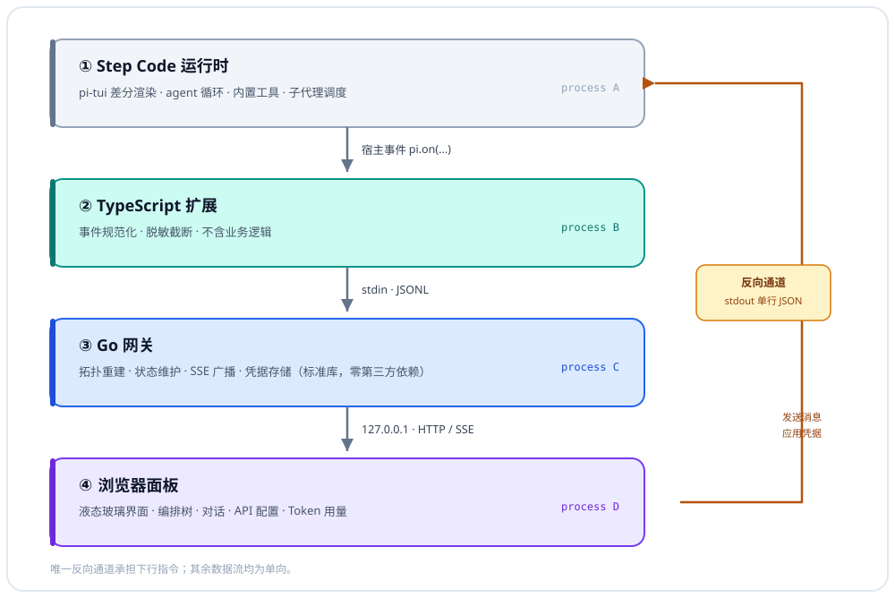

# StepFun Code-GUI

**v2.0.0** · **简体中文** · [English](README.en.md)

[](LICENSE)
[](package.json)
[](#快速开始)

Step Code 的子代理编排可视化面板。终端中运行的 `subagent` / `workflow` 编排，
以液态玻璃界面在浏览器中实时呈现。

> 内部包名为 `step-orchestra`；仓库与产品名称为 StepFun Code-GUI。

---

## 功能特性

- **实时编排拓扑** —— 订阅宿主事件重建 `tool_call` / `tool_update` / `tool_result` 拓扑，节点状态覆盖 pending / running / done / failed / cancelled。
- **扇出模式推断** —— 按参数形状区分 single / parallel / chain（`agent` / `tasks` / `chain`），不依赖显式 `mode` 字段；模式徽标与任务摘要直接上卡。
- **子代理明细与聚合指标** —— 节点详情展示子代理行、进度与脱敏参数；顶栏汇总运行中 / 已完成 / 失败 / 编排数与 token 总消耗。
- **对话视图与无缝切换** —— 会话历史回放、80 ms 合帧流式气泡、贴底滚动；编排 ↔ 对话切换不卸载 DOM，滚动位置、选中节点与输入草稿全部保留。
- **多账户 API 配置热切换** —— 凭据由网关持有，浏览器只见 `keyHint` 掩码；`registerProvider` 免重启生效，401 / 403 时标红并给出原因。
- **Token 用量单行指标** —— `tok/s`、首字延迟、输出 / 生成耗时、均值、累计与上下文占用；≥75% / ≥92% 整行变色并提示。
- **液态玻璃视觉** —— `backdrop-filter` 折射底、142° 玻璃体、指针高光、≤4.5° 视差倾斜与 SVG 位移滤镜，并提供 `prefers-reduced-motion` 降级。
- **零命令行启用与性能模式** —— 双击 `start.bat` / `start.command` 自动构建并拉起网关；`npm run demo` 无需 Step Code 即可预览；性能模式一键降载，并在低配设备与后台标签页自动生效。

---

## 快速开始

**方式一（推荐，零命令行）：**

| 平台 | 操作 |
|---|---|
| Windows | 双击 `start.bat` |
| macOS | 双击 `start.command`（即 `start.sh`），或在终端运行 `./start.sh` |
| 任意平台（已装 Node ≥ 22） | 在仓库根目录运行 `npm start` |

启动器会自动完成剩余一切：定位（或用 Go 构建）网关二进制、启动网关、
自动打开浏览器。首次运行需 10–30 秒构建，之后即点即开。

**方式二（体验模式，无需安装 Step Code）：**

```bash
npm run demo        # 等价于 node start.mjs --demo
```

回放一组完整场景（workflow 并行扇出 + subagent 串行链 + 对话流 + 用量指标），
用于快速查看面板效果；回放完成后断言 38/38 输出，网关保持运行供浏览。

**方式三（开发者，手动构建）：**

```bash
npm run build       # 等价于 go build（自动处理 Windows .exe 后缀）
```

> 网关为标准库 Go 程序（产物约 7 MB，`-trimpath -ldflags "-s -w"` 裁剪），
> 构建仅需 Go 工具链，无任何第三方依赖；其余一切仅需 Node ≥ 22。

---

## 安装

将扩展安装到 Step Code：

```bash
step install /absolute/path/to/step-orchestra
step list
```

安装完成后，在 Step Code 中执行 `/orchestra`，将输出面板地址：

```text
[step-orchestra] panel: http://127.0.0.1:47810/#t=<token>
```

token 位于 URL **片段**（`#t=`），不会发送给服务器、不会进入 `Referer`；
页面加载后 `web/token.js` 会立即用 `history.replaceState` 把地址栏还原为
`http://127.0.0.1:47810/`，并按标签页保存在 `sessionStorage` 中，因此刷新可用、
复制出的地址不含密钥。**v2.0.0 及更早版本使用的查询串地址已不再可用**，请重新运行
`/orchestra` 获取新地址。

网关随扩展加载自动启动，并在会话结束时退出，无需额外配置。

**无需手动构建。** 若扩展启动时发现网关二进制缺失，会自动在后台调用
Go 构建（仅首次，约 10–30 秒，完成后日志提示再次运行 `/orchestra`）；
期间事件在内存中排队，构建完成后一次性回放，面板首屏不缺数据。
安装前先运行一次 `start.bat` / `npm start` 的用户则完全不会遇到该等待。
设置环境变量 `STEP_ORCHESTRA_AUTOBUILD=0` 可关闭该行为。

### 包结构

`package.json` 通过 `"pi": { "extensions": ["extensions/index.ts"] }` 声明入口
（对应官方 `with-deps` 示例的写法；**顶层** `extensions` 字段宿主不予识别）。

`step install` 将来源写入 `~/.stepcode/config.toml`：

```toml
# StepCode configuration
packages = [ "E:\\Project\\...\\step-orchestra" ]
```

> 官方文档描述为 `~/.stepcode/agent/settings.json`，实测 0.1.1 版本写入
> `~/.stepcode/config.toml`。以 `step list` 的输出为准。

亦可绕过安装流程，使用 `step -e <入口路径>` 临时加载。

---

## 使用与命令

| 命令 | 作用 |
|---|---|
| `npm start` | 一键启动：定位或构建网关、启动并在默认浏览器打开面板 |
| `npm run demo` | 回放内置场景，无需安装 Step Code |
| `npm run build` | 仅构建网关二进制 |
| `npm test` | 运行聚合测试（go vet / go test / 模块图 / 载荷解析 / 层叠 / 启动器 / 端到端） |
| `step install <路径>` | 将扩展安装到 Step Code |
| `step -e <入口路径>` | 临时加载扩展，绕过安装流程 |
| `/orchestra` | 在 Step Code 中输出面板地址并启动网关 |

最小示例：

```bash
npm start
```

启动后浏览器自动打开面板。已安装扩展时，可在 Step Code 中执行 `/orchestra`
获取带 token 的面板地址（token 每次运行都会变化）。

---

## 配置

### API 配置切换

支持在多个账户的 coding Plan 之间切换，无需重启。

#### 配置存储

| 项 | 决定 |
|---|---|
| 位置 | `~/.stepcode/agent/step-orchestra/profiles.json`（由网关写入） |
| 权限 | 目录 `0700`、文件 `0600`；**Windows 上这两个权限位不生效**，同机其他账户是否可读由 `%USERPROFILE%` 的 ACL 决定 |
| 原子性 | 先写入 `.tmp` 再 rename，崩溃不会截断原文件 |
| 格式 | `{ version, activeId, profiles: [{ id, name, provider, apiKey, baseUrl?, addedAt }] }` |
| 加密 | **不加密**。与 `.netrc`、`~/.aws/credentials` 采取同级做法：明文存储并依赖文件权限 |
| 浏览器 | **不接触明文**。列表接口仅返回 `keyHint`（形如 `sk-m…7890`） |

> **Windows 权限说明（A-03）**：Go 的 `os.WriteFile(..., 0o600)` 与 `MkdirAll(..., 0o700)`
> 在 Windows 上只会映射为只读属性，不会生成 ACL 条目；`profiles.json` 的机密性因此取决于
> `%USERPROFILE%\.stepcode\` 的继承 ACL（默认仅当前用户与其管理员组可读）。若需显式收紧，可执行：
>
> ```bat
> icacls "%USERPROFILE%\.stepcode\agent\step-orchestra" /inheritance:r /grant:r "%USERNAME%":(OI)(CI)F
> ```
>
> 本项目不引入 DPAPI / Keychain 等平台凭据库（与“零第三方依赖”取向冲突），如需更高保证
> 请使用系统凭据管理器保存密钥，并仅在面板中临时激活。

选择由网关持有明文，而不使用浏览器 localStorage：localStorage 对同源脚本完全可读，
而面板本身运行于 localhost，将密钥置于浏览器等同于交付给任意注入脚本。

#### 切换的即时生效机制

Step Code 的凭据经由 model registry 解析。官方文档明确：`registerProvider`
在初始加载阶段之后调用**立即生效，无需 `/reload`**；且配置形式仅覆盖传入字段，
模型目录保持不变。

```text
点击切换 → POST /api/profiles/activate → 网关写 activeId
        → stdout 下发 action{apply_profile, profile}
        → 扩展 pi.registerProvider(provider, { apiKey })
        → 下一个请求即使用新凭据
```

由于仅传入 `apiKey`（及可选的 `baseUrl`），该 provider 的模型列表不会被重置。

#### 失效检测

不主动探测端点，而是**监听真实流量**：扩展订阅 `after_provider_response`，
收到 401 / 403 时广播 `profile_status`，面板将当前配置标红并给出原因。
该方案不产生额外请求与计费。

表单侧的静态校验：名称与 provider 为必填；新增时密钥为必填；
密钥长度不足 12 字符标记为「长度异常」。

#### 交互设计

| 元素 | 行为 |
|---|---|
| 触发按钮 | topbar 右侧，位于 metrics 与「对话」切换键之间；含状态点、账户名与掩码密钥 |
| 状态点 | 绿色为可用；灰色为缺少密钥；琥珀色为长度异常；红色为凭据被拒绝（含呼吸动画） |
| 展开 | 点击展开玻璃浮层，同步 `aria-expanded`，箭头翻转 |
| 关闭 | 点击外部、按 Esc，或再次点击 |
| 列表项 | 名称 +「当前」徽标 + provider / 掩码 / baseUrl + 状态描述；当前项不可重复点击 |
| 行内操作 | 编辑、删除；删除经由原生 `confirm` 二次确认 |
| 悬停 / 按下 | 与模式切换键一致：上浮 1 px / `scale(0.978)` |
| 编辑 | 密钥留空即保留原值（由服务端合并），浏览器无需回填未曾获得的密钥 |

### 环境变量

| 变量 | 必填 | 说明 |
|---|---|---|
| `STEP_ORCHESTRA_PORT` | 否 | 网关起始端口，默认 `47810`；冲突时自动顺延（至多 12 次） |
| `STEP_ORCHESTRA_BIN` | 否 | 覆盖网关二进制路径（默认自动定位或构建） |
| `STEP_ORCHESTRA_WEB` | 否 | 面板静态目录；仅接受仓库内 `web/`，其他路径会被忽略并记日志 |
| `STEP_ORCHESTRA_AUTOBUILD` | 否 | 设为 `0` 关闭扩展侧首次自动构建；默认开启 |

---

## 架构

**设计依据。** Step Code 的 UI 层为 `pi-tui`，采用终端字符差分渲染，插件不具备注入自定义图形组件的公开 API；
终端亦无法呈现真实的模糊与折射效果。基于此约束，系统按职责划分为四个进程：

| 层 | 职责 |
|---|---|
| TypeScript 扩展 | 将宿主事件规范化为 JSONL 并写入子进程 stdin，不含业务逻辑 |
| Go 网关 | 重建拓扑、维护状态，并通过 SSE 推送 |
| 浏览器面板 | 承担全部图形渲染与动效 |
| 反向通道 | 经网关 stdout 回传指令，用于发送消息与应用凭据 |



该分层的主要收益在于变更隔离：宿主 API 调整仅影响 `extensions/` 目录，
且面板可脱离 Step Code 独立开发与调试。

### 事件契约

扩展订阅以下宿主事件（`pi.on(event, handler)`），字段定义以 `extensions/types.ts` 为准。

| 宿主事件 | 用途 |
|---|---|
| `session_start` | 会话元信息（ID / cwd / 模型） |
| `agent_start` / `agent_end` / `agent_settled` | 轮次与整体结算 |
| `tool_call` | 节点创建；`subagent` / `workflow` 标记为编排节点并提取模式 |
| `tool_execution_update` | **编排进度的主数据源**。0.1.1 载荷位于 `event.partialResult`，0.84.x 位于 `event.details`，两者均予解析 |
| `tool_result` | 节点终态、耗时、token 用量 |
| `message_start` / `message_update` / `message_end` | 对话流：取 `assistantMessageEvent.text_delta` 累积为流式气泡 |
| `session_shutdown` | 关闭网关 |

`message_update` 按 token 触发，仅取 `assistantMessageEvent.type === "text_delta"` 的增量；
thinking 与 toolcall 增量不予转发，因其已以工具节点的形式呈现。

#### 上游健壮性

`extensions/progress.ts` 为每个计数字段维护一份**别名表**
（如 `running` 对应 `running` / `runningCount` / `active` / `activeCount`），
并在 `partialResult` / `progress` / `workflowProgress` / `snapshot` / `details`
等包装层下钻至多三层。宿主重命名字段时降级为**部分读取**，而非整块面板空白。

上游版本间存在实测差异：

| 项 | 0.1.1 | 0.84.x |
|---|---|---|
| 进度载荷字段 | `event.partialResult` | `event.details` |
| `subagent` 工具 | 由示例扩展提供，参数为 `{agent\|tasks\|chain}` | 内置，另有 `workflow` 工具 |
| 安装配置落点 | `~/.stepcode/config.toml` | 文档称 `settings.json` |
| 包入口声明 | `"pi": { "extensions": [...] }` | — |

因此 `inferMode()` 依据**参数形状**推断扇出模式：存在 `chain` 数组判定为 chain，
存在 `tasks` 数组判定为 parallel，存在 `agent` 或 `task` 判定为 single，
不依赖显式的 `mode` 字段。

### 安全设计

| 项 | 措施 |
|---|---|
| 网络暴露 | 仅绑定 `127.0.0.1`，端口冲突时自动顺延（至多 12 次）；并校验 `Host` 必须为 `127.0.0.1` / `localhost`，阻断 DNS rebinding |
| 鉴权 | 每次运行生成 24 字节随机 token；所有数据端点校验，采用常数时间比较 |
| token 传递 | token 只放在 URL 片段（`#t=`），页面读取后立即从地址栏与历史记录中清除；只读 GET 额外接受查询参数，`POST` / `DELETE` **只接受 `X-Orchestra-Token` 请求头**，因此从 UI 地址泄露的 token 无法用于写操作 |
| 跨站写保护 | `POST` / `DELETE` 校验 `Origin`：缺失视为本地 CLI（仍需 token 头），存在则必须与请求 `Host` 完全一致，否则返回 403 |
| 静态资源 | 无 token 校验（首屏无需额外请求），但只服务仓库内 `web/`；`STEP_ORCHESTRA_WEB` 若指向其他目录会被忽略并记日志，避免把任意目录暴露到回环地址 |
| 凭据泄露 | 参数经 `redact.ts` 处理：`key` / `token` / `secret` / `password` / `authorization` / `cookie` 等键整值替换为 `***` |
| 体积膨胀 | 单字符串截断至 2048 字符，每层至多 24 个键，递归深度上限为 4 |
| 注入 | 前端一律以 `textContent` 写入宿主数据；`innerHTML` 仅用于本文件内声明的静态图标路径 |
| 数据落盘 | 网关不写浏览数据；token 仅在扩展进程内存与浏览器同标签的 `sessionStorage` 中流转 |
| 首次自动构建 | 扩展/启动器在二进制缺失时调用本机 Go 构建**仓库内源码**：不联网、不启用 shell、不拼接参数；等价于“安装即执行该仓库”，属安装信任模型（见「已知限制」） |

### 对话模式与视图切换

面板包含两个视图：**编排**（工具与子代理拓扑）与**对话**（与 agent 的交互）。
二者在同一 grid 单元格内常驻挂载，切换操作仅翻转可见性。

#### 切换按钮

| 项 | 设计 |
|---|---|
| 位置 | topbar 右端、连接状态指示灯左侧，属全局视图控件，不隶属任一列面板 |
| 文案 | 显示**目标模式**：编排视图下显示「对话」，对话视图下显示「编排」 |
| 图标 | 与文案联动，目标为对话时显示气泡，目标为编排时显示节点图；由 CSS 依据 `data-target` 切换，不替换 DOM |
| 悬停 | 上浮 1 px、描边转主题紫、玻璃高光增强（240 ms） |
| 按下 | `scale(0.972)`，过渡压缩至 90 ms |
| 焦点 | `:focus-visible` 2 px 紫色外圈，支持键盘可达 |
| 过渡中 | `aria-busy="true"` 配合 `pointer-events: none`，在 240 ms 窗口内抑制重复触发 |
| 禁用 | 事件流断开时禁止切换（`opacity: .45`、`cursor: not-allowed`、无悬停反馈） |

#### 切换过程的稳定性保障

| 风险 | 处理 |
|---|---|
| 布局跳动 | 两视图共享同一 `grid-area: stage` 单元格重叠，容器尺寸恒定 |
| 重建闪烁 | 视图**不卸载**，切换仅改变 `opacity` 与 `visibility` |
| 滚动丢失 | DOM 存活，编排树与对话的滚动位置原样保留 |
| 选中丢失 | 选中节点为 DOM 属性，不随切换变化 |
| 草稿丢失 | 输入框 DOM 存活，切换后内容与光标位置均保留 |
| 数据重载 | 切换**不发起任何请求**；SSE 持续写入两个视图 |
| 动画竞态 | 240 ms `aria-busy` 窗口抑制重复触发；`prefers-reduced-motion` 下过渡降至 0.01 ms |

#### 对话数据流

```text
输入框 ──POST /api/send──▶ 网关 ──stdout 单行 JSON──▶ 扩展 ──pi.sendUserMessage()──▶ 宿主
宿主 ──message_start/update/end──▶ 扩展（累积 text_delta）──▶ 网关 ──SSE──▶ 气泡原地更新
```

上述反向通道为系统内唯一的下行路径：stdin 承载上行事件，stdout 承载下行指令。

发送按钮的禁用条件为复合判定：输入为空，或事件流断开。**agent 忙碌时仍可发送**：
扩展将自动降级为 `deliverAs: "followUp"` 排队等待；消息在本地先以半透明「待达」
气泡回显，宿主回放后原位替换，发送失败时原文回填输入框。

消息气泡按 id 复用 DOM，流式更新仅修改文本节点，不重建列表。滚动采用贴底策略
（距底部不足 72 px 时自动跟随，否则显示「回到底部」按钮），避免打断向上翻阅。

### Token 用量显示

位于对话视图底部、输入框上方的单行指标文本，形式参照
[`Neriah-Ado/stepfun-usage-monitor`](https://github.com/Neriah-Ado/stepfun-usage-monitor)
的回复底部指标行。

```text
537.3 tok/s · 首字 3.0s · 输出 223 tok / 生成 0.4s · 均值 494.9 · 累计 51.3k tok · 上下文 168k/200k · 接近上限 · 10:23:04
```

| 项 | 设计 |
|---|---|
| 形态 | **单行纯文本**、等宽字体、中点分隔；无进度条与独立面板背景 |
| 位置 | 对话日志与 composer 之间，归属输入区 |
| 时机 | `message_end`；数值仅在响应落地时变化，不轮询、不随 token 抖动 |
| 数字规则 | **双轨制**：精确值采用千分位（`2,762`）；累计值采用紧凑单位 —— 小于 1k 保留原值、1k 至 10k 保留一位小数（`9.8k`）、10k 至 1M 取整（`51k`）、不小于 1M 保留一位小数（`73.8M`） |
| 时刻 | 右对齐、等宽，不参与文本截断 |
| ≥75% / ≥92% | 整行转琥珀色 / 红色，并追加「接近上限」/「即将溢出，建议 /compact」 |

#### 速率的计算方式

扩展层可用的时钟仅为事件到达时间戳，因此：

```text
TTFT      = 首个 text_delta 到达 − message_start
生成耗时   = 最后一个 text_delta − 第一个 text_delta
tok/s     = 本轮输出 token ÷ 生成耗时 × 1000
```

两处保守处理：生成窗口短于 200 ms 或长于 1 h 的样本不计入滑动平均（属噪声而非吞吐）；
仅存在单个 delta 时 `generationMs` 记为 `null` 而非 0，避免前端得出异常数值。
TTFT 包含 IPC 延迟，读数偏高，作为仪表指示可接受。

#### 「上下文占用」字段的保留依据

参照项目呈现的是**速率**，而本项目所需的上下文占用是**窗口余量**，两者语义不同。
因此实现采取融合方案：形式与数字规则沿用参照项目，字段以速率类为主，
同时保留上下文占用与告警 —— 因为「接近上限」是该行内唯一可行动的信号。

### 性能模式

液态玻璃的三个持续 GPU 开销来源——极光背景动画、`backdrop-filter` 采样、
指针视差/高光——在低配设备与后台标签页上纯属浪费。V2.0 为此引入一键降载：

| 项 | 设计 |
|---|---|
| 开关 | topbar「性能」按钮；开启后显示「省电」并转为琥珀色描边 |
| 降载内容 | 极光动画冻结为静态渐变；全部 `backdrop-filter` 关闭（换用不透明渐变，可读性不变）；入场/呼吸/脉冲等持续与一次性动画关闭；`glass.js` 跳过全部指针追踪（含每次 move 的 `getBoundingClientRect`） |
| 自动启用 | 首次访问且无本地选择时：`prefers-reduced-motion`、≤ 4 逻辑核或 ≤ 4 GB 内存的设备默认开启省电模式 |
| 持久化 | 用户手动切换后写入 `localStorage`（key `step-orchestra:perf-lite`）；自动默认值不落盘，换设备不误伤 |
| 后台休眠 | 标签页隐藏时自动暂停极光等持续动画（`html.perf-paused`），回到前台恢复 |
| 降级不降级面 | 状态色（运行/完成/失败 rail、呼吸改为静态描边）全部保留，层级与可读性不受影响 |

### 液态玻璃实现

| 层次 | 手段 |
|---|---|
| 折射底 | `backdrop-filter: blur(22px) saturate(175%)` |
| 玻璃体 | 142° 白色渐变 + 1 px 高光描边 + 四向 `inset` 阴影模拟厚度 |
| 镜面高光 | `radial-gradient` 跟随 `--gx` / `--gy`，由 `glass.js` 写入 |
| 立体感 | 卡片跟随 `--rx` / `--ry` 产生不超过 4.5° 的视差倾斜 |
| 液态形变 | 空状态光环应用 SVG `feTurbulence` 与 `feDisplacementMap` |
| 性能护栏 | rAF 合并指针事件；节点入场动画采用 `backwards` 而非 `both`（后者会锁定 `transform` 导致悬停失效）；`contain: layout paint`；topbar「性能」开关一键降载（见上一节） |
| GPU 护栏 | `backdrop-filter` 只保留在 topbar 与两块面板等大面上，节点卡片不用（逐卡背景采样是规模下的主要开销）；运行节点的「呼吸」动画只驱动专用覆盖层的 `opacity`，不逐帧重绘 `box-shadow`；卡片无常驻 `will-change` |
| 降级 | `@supports not (backdrop-filter)` 时降为高不透明纯色面板；`prefers-reduced-motion` 下关闭全部动效 |

> 真实折射需要扭曲背景内容，而 CSS 无法对 `backdrop` 施加位移滤镜。
> 因此折射感由高光、内阴影与倾斜共同营造；SVG 位移滤镜仅用于装饰性元素，以避免文字扭曲。

### 项目结构

```text
step-orchestra/
├── start.mjs            # 一键启动器：定位/构建网关、启动、自动开浏览器
├── start.bat            #   Windows 双击入口
├── start.sh             #   macOS / Linux 入口（start.command 同内容）
├── extensions/          # Step Code 扩展（TypeScript，ESM，Node ≥ 22）
│   ├── index.ts         #   入口：事件订阅与转发
│   ├── bridge.ts        #   Go 子进程生命周期 + 反向通道解析 + 缺失时自动构建
│   ├── conversation.ts  #   对话镜像：历史回放 / 流式累积 / 发送
│   ├── metrics.ts       #   回合计时与吞吐计算
│   ├── profiles.ts      #   凭据应用：registerProvider 热切换
│   ├── progress.ts      #   WorkflowProgress 防御式解析
│   ├── redact.ts        #   脱敏与截断
│   └── types.ts         #   线协议
├── gateway/             # Go 网关（标准库，零第三方依赖）
│   ├── main.go          #   stdin 读取 + HTTP/SSE + REST 端点
│   ├── state.go         #   拓扑状态机
│   ├── state_test.go    #   状态机单元测试（V2.0 新增）
│   ├── conversation.go  #   对话日志（有界、按 id 索引）
│   ├── profiles.go      #   凭据存储（原子写、掩码投影）
│   └── hub.go           #   SSE 广播
├── web/                 # 浏览器面板（零构建，原生 HTML/CSS/JS）
│   ├── perf.js          #   性能模式：自动检测 / 持久化 / 后台休眠（V2.0 新增）
│   ├── token.js         #   面板 token 引导：读取 URL 片段、清除地址栏、sessionStorage
│   ├── liquid-glass.css #   设计系统 + 视图栈 + 切换按钮 + 配置面板 + perf-lite
│   ├── glass.js         #   指针高光 / 视差倾斜（性能模式下跳过）
│   ├── tree.js          #   编排树渲染（增量复用）
│   ├── chat.js          #   对话视图（气泡复用 + 贴底滚动）
│   ├── profiles.js      #   API 配置选择器
│   └── app.js           #   SSE 客户端 + 模式切换 + 详情面板
├── docs/
│   └── architecture.svg #   架构图
└── tools/
    ├── mock-feed.mjs    # 端到端验证（编排 + 对话 + 反向通道 + 凭据 + 用量）
    ├── test-progress.mjs# 宿主载荷解析回归
    ├── test-launcher.mjs# 启动器单元回归（V2.0 新增）
    ├── test-token.mjs   # 面板 token 引导回归（fragment / 地址栏 / sessionStorage）
    ├── test-extension-import.mjs # 扩展模块图冒烟（V2.0 新增）
    ├── run-all-tests.mjs# 聚合入口，支持 --rounds 多轮（V2.0 新增）
    └── check-layers.mjs # 层叠关系静态校验
```

前端调试流程：执行 `npm run demo`（或 `node tools/mock-feed.mjs --serve`），
修改文件后刷新浏览器即可生效，无需构建。

---

## 验证状态

聚合入口：`npm test`（或 `node tools/run-all-tests.mjs --rounds 3` 做多轮浸泡）。

| 项 | 状态 |
|---|---|
| 扩展被 Step Code 加载并执行 | 已实测（`step -e` 与自动发现两条路径） |
| 自动发现（`step install` → `config.toml`） | 已实测（`step list` 确认） |
| 扩展生命周期钩子 | 已实测（`session_shutdown` 后网关优雅退出，无残留进程） |
| 端口冲突自动避让 | 已实测（47810 被占用时顺延至 47811） |
| 网关与前端数据链路（编排 / 对话 / 反向通道 / 凭据 / 用量） | `tools/mock-feed.mjs` **38/38** 断言（含读写鉴权、跨站 Origin、静态资源） |
| 宿主载荷解析 | `tools/test-progress.mjs` 11/11 断言 |
| 网关状态机（生命周期 / 逐出 / 占位 / 序号 / 统计） | `gateway/state_test.go` 6 组 `go test`（V2.0 新增） |
| 启动器决策逻辑（平台命名 / 参数 / 候选解析 / fragment URL 抓取） | `tools/test-launcher.mjs` 8/8 断言（V2.0 新增） |
| 面板 token 引导（片段解析 / 地址栏清除 / sessionStorage 回退） | `tools/test-token.mjs` 6/6 断言 |
| 扩展模块图加载与导出面 | `tools/test-extension-import.mjs`（V2.0 新增） |
| 凭据持久化落盘 | 已实测，`profiles.json` 写入且包含密钥 |
| 明文密钥不外泄至浏览器 | 已实测，响应体不含明文 |
| 配置浮层层叠关系 | `tools/check-layers.mjs` 11/11（已验证该脚本可捕获原缺陷） |
| 反向通道鉴权（无 token 拒绝） | 已实测返回 401 |
| 性能模式（开关 / 持久化 / 后台休眠） | V2.0 新增，浏览器手工 + 脚本验证 |
| 真实 agent 事件流（tool_call / 消息流） | **未验证** —— 需登录后运行真实任务方可触发 |
| `registerProvider` 热切换实际生效 | **未验证** —— 需登录后观察下一个请求 |

### 层叠关系的复核方式

```bash
node tools/check-layers.mjs      # 静态判定，11 项断言
```

判据为纯静态：**后代元素无法越过其所属的层叠上下文根**。因此仅需校验
「`.topbar` 的 z-index 严格大于 `.stage`」这一不变量，即可保证嵌套于 `.topbar`
内的配置浮层不被内容区遮挡。该脚本在修复过程中经反向验证 ——
将 `z-index` 改回 `2` 会立即降至 9/11 并返回非零退出码。

面板上的手工确认方式：点击 topbar 的「配置」按钮，浮层应完整覆盖于编排树与对话区之上；
将窗口缩小至 1080 px 以下（`.stage` 切换为单列布局）后仍应保持该行为。

---

## 已知限制

- **真实 agent 事件流未验证。** `~/.stepcode/auth.json` 为空（未登录），
  且非 TTY 环境下 step 不建立真实会话，因此 `session_start` 与工具事件未实际触发。
  登录后执行一次 `subagent` 调用即可补齐该环节。
- **接口形状按 0.1.1 实测校准。** 若升级至 0.84.x，`partialResult` 将变为 `details`，
  `subagent` 可能转为内置工具并新增 `workflow`；解析层已同时兼容。
- **子代理明细为聚合数据。** 子代理运行于独立进程，主进程无法观测其内部工具调用，
  面板仅能呈现宿主在进度快照中给出的 agent 行。
- **扇出仅一层。** 此为 Step Code 的约束，因此树最深两层。
- **首次构建需 Go 工具链。** 二进制不随仓库分发（`bin/` 不入库）；
  扩展侧与启动器均会自动构建，但机器上仍需安装 Go（https://go.dev/dl）。
- **首次构建属安装信任模型。** 构建只执行仓库内 Go 源码（不联网、不启用 shell、不拼接参数），
  但“安装该仓库”本身等价于“在本机执行其源码”，请只安装可信来源。
- **端口固定于 47810–47821。** 全部占用时启动失败，并在 `/orchestra` 中给出原因。

---

## 故障排查

| 现象 | 处理 |
|---|---|
| `/orchestra` 提示 binary missing / Go 不可用 | 双击 `start.bat`（或 `npm start`）一次；或安装 Go 后运行 `/orchestra` 触发自动构建 |
| 双击 start.bat 闪退 | 未安装 Node.js ≥ 22，从 https://nodejs.org 安装后重试 |
| 面板持续显示「连接中」 | 检查地址中的 `#t=` 片段是否完整；token 每次运行均会变化。页面加载后地址栏中的 `#t=` 会被清除，属正常现象 |
| 使用旧版查询串地址 | v2.0.0 及更早的查询串地址已失效；重新运行 `/orchestra`，使用输出的 `#t=` 新地址 |
| 面板显示「会话已失效」 | 网关进程已重启并更换了 token，重新运行 `/orchestra` 打印新地址后打开 |
| 节点未出现 | 确认触发的是 `subagent` / `workflow`；普通工具调用需关闭「仅编排」筛选 |
| 端口被占用 | 通过 `STEP_ORCHESTRA_PORT=50000` 环境变量覆盖起始端口，或 `npm start -- --port 50000` |
| 自定义网关路径 | 通过 `STEP_ORCHESTRA_BIN=/path/to/gateway` 环境变量覆盖 |
| 想关闭自动构建 | 设置 `STEP_ORCHESTRA_AUTOBUILD=0` |

---

## 发布说明

| 版本 | 主题 | 发布说明 |
|---|---|---|
| v2.0.0 | 一键启用、性能模式与多轮可靠性验证 | [docs/releases/v2.0.0.md](docs/releases/v2.0.0.md) |
| v1.5.0 | 稳定性、并发正确性与渲染性能修复 | [docs/releases/v1.5.0.md](docs/releases/v1.5.0.md) |
| v1.0.0 | 首个公开版本 | [docs/releases/v1.0.0.md](docs/releases/v1.0.0.md) |

逐版本变更见 [CHANGELOG.md](CHANGELOG.md)。

---

## 许可证

本项目采用 **GNU Affero 通用公共许可证第 3 版（AGPL-3.0-only）**。
完整许可文本见 [LICENSE](LICENSE)。

© 2026 Neriah

### 使用限制与要求

| 使用方式 | 要求 |
|---|---|
| 自行运行（含内部生产环境） | 无附加要求 |
| 分发本软件或其修改版 | 以 AGPL-3.0 提供完整对应源码；保留版权与许可声明；标明修改内容与日期 |
| 修改后分发 | 修改部分同样受 AGPL-3.0 约束 |
| 以网络服务形式提供 | 须向所有远程交互用户提供获取对应源码的显著途径（第 13 条） |
| 集成进其他程序 | 若构成衍生作品，整个作品须以 AGPL-3.0 授权 |
| 商业使用 | 允许，但上述要求不因此豁免 |

- 不得移除或规避版权与许可声明；
- 不得将衍生作品改为更宽松的许可证；
- 不得附加与本许可证相冲突的进一步限制（GPLv3 第 10 条）；
- 违反许可证时授权自动终止，须由版权人恢复（第 8 条）。

文档规范：[DOCS-STYLE](https://github.com/Neriah-Ado/Neriah-Ado/blob/main/docs/DOCS-STYLE.md)
